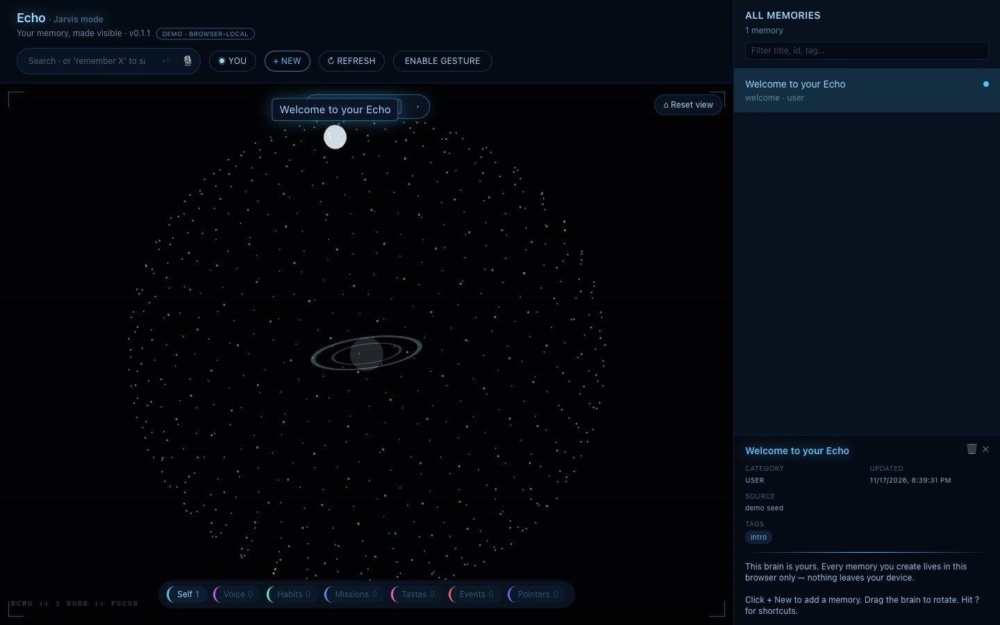
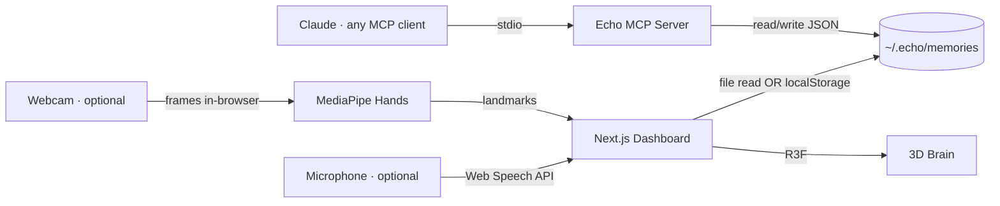

<div align="center">



# Echo

### Your AI's brain, externalized.

A personal **memory MCP server** + **3D brain dashboard** with hover-dwell gestures, voice-to-save, and a chat-preview replay of how every memory was born.

[**Live demo →**](https://echo-ruby-omega.vercel.app) &nbsp;·&nbsp; [**MCP server**](#the-mcp-server) &nbsp;·&nbsp; [**Architecture**](#architecture) &nbsp;·&nbsp; [**Roadmap**](#roadmap)

[](LICENSE)
[](#roadmap)
[](#stack)
[](https://github.com/Waleee7)

</div>

<p align="center"></p>
<p align="center"><sub>Demo mode, local production build, 2026-11-17, with the seeded welcome memory selected.</sub></p>

---

## Why Echo exists

Most memory layers for AI are key-value stores with extra steps. You save a string, you retrieve a string. There is **no shape** to what your AI knows about you — no sense of weight, recency, relationships, or self.

Echo treats memory as a **living thing**: categorized into seven brain regions, time-decayed, link-aware, and rendered as a rotating cyan sphere you can grab with your cursor, your voice, or your hand.

The pitch isn't "look at my memory dashboard." The pitch is **"this is what my AI knows about me, and I can feel it."**

## What you can do

| | |
|---|---|
| 🧠 **See your memory** | A 3D React Three Fiber brain with one glowing dot per memory, anchored to a region by category, sized by freshness, edge-linked to related ideas. |
| 🎙️ **Voice-to-save** | Type or say `"remember I'm allergic to peanuts"` — intent detected, memory created, dot lands on your brain. |
| 💬 **Chat preview** | Every memory carries the conversation that created it. Click a dot → see the snippet. Click again → full transcript. Memories with stories, not stamps. |
| 👆 **Gesture control** | Enable webcam → MediaPipe hand-tracking shows a cyan cursor → hover any dot for 0.75 s → it selects. Pinch as instant backup. |
| 🪞 **Who you are** | One-click synthesized profile: top region, top tags, oldest / newest memory, freshness pulse. |
| 🔗 **Auto-related** | New memories Jaccard-match existing ones on tags + tokens. Edges emerge organically — no manual linking. |

## How it works in 30 seconds

1. Echo runs as an **MCP server**, exposing five tools to Claude: `save_memory`, `recall`, `search`, `list_by_category`, `forget`.
2. Each memory is a **plain JSON file** in `~/.echo/memories/` (or `$ECHO_DIR/memories/` when `ECHO_DIR` is set), with provenance, freshness score (30-day half-life), and an optional chat transcript.
3. The **Next.js dashboard** reads the same files and renders them as a 3D brain. Or — in deployed demo mode — uses your browser's `localStorage` so every visitor gets their own fresh brain.



## Quick start

```bash
git clone https://github.com/Waleee7/echo.git
cd echo

# 1. Build the MCP server
cd server && npm install && npm run build

# 2. Register with Claude Code (or Desktop)
claude mcp add echo node "$PWD/dist/index.js" --scope user

# 3. Run the dashboard
cd ../dashboard && npm install && npm run dev
# → http://localhost:3000
```

Then in any Claude session: *"save a memory that I prefer dark mode"* — Echo's tools light up, the dashboard's brain grows a new dot.

## Demo mode (for a hosted version)

Build the dashboard with `NEXT_PUBLIC_DEMO_MODE=true` and it needs no backend: every visitor gets their **own** browser-local brain in `localStorage`, seeded with one welcome memory, and nothing is shared between visitors. Without the flag, the dashboard reads and writes the same memory files as the MCP server, which is the full version for your own machine.

```bash
cd dashboard && NEXT_PUBLIC_DEMO_MODE=true npm run build && npx next start
```

## The MCP server

| Tool | Signature | What it does |
|------|-----------|--------------|
| `save_memory` | `(id, title, body, category, tags?, relatedIds?, source?, sessionId?)` | Create a memory, or update it if the id exists. The id is a stable kebab-case slug. |
| `recall` | `(id)` | Pull the full body of one memory. |
| `search` | `(query, limit?)` | Free-text rank across title + body + tags. |
| `list_by_category` | `(category?)` | List memories, optionally filtered, sorted by freshness. |
| `forget` | `(id)` | Delete a memory from disk. |

## Brain regions

Seven categories, seven anchored zones on the sphere:

| Category | Region | What lives here |
|----------|--------|-----------------|
| `user` | **Self** | Who you are — role, expertise, ongoing goals |
| `persona` | **Voice** | How you want the AI to talk and behave |
| `feedback` | **Habits** | Corrections and validated approaches |
| `project` | **Missions** | Active work, deadlines, motivations |
| `preference` | **Tastes** | Defaults, small choices, formatting |
| `incident` | **Events** | Notable moments worth remembering |
| `reference` | **Pointers** | Where to look in external systems |

## Controls

Click the **◐ drag** pill at the top of the brain for the full list. Highlights:

| | |
|---|---|
| **Drag** | rotate brain · **scroll** zoom · **click** focus memory |
| **← →** | cycle memories (freshness-sorted) · **Esc** close / clear |
| **🎙 + "remember X"** | save by voice or by typing the prefix |
| **👆** | hover a dot 0.75 s in gesture mode to select |
| **🤏** | pinch as instant select (cursor latches so it doesn't drift right) |
| **⌃ ↵** | save in the New Memory modal |

## Stack

| Layer | Tech |
|-------|------|
| MCP server | TypeScript · `@modelcontextprotocol/sdk` · Node stdio |
| Storage | Plain JSON files (or browser `localStorage` in demo mode) |
| Dashboard | Next.js 15 · React 19 · Tailwind · React Three Fiber · drei |
| Vision | MediaPipe Tasks Vision — hand landmarker, browser-local |
| Voice | Web Speech API — speech recognition, continuous mode |

## Tests and builds

There is no automated test suite yet. Checked on 2026-11-17:

- **Builds:** `npm run build` passes in `server/` (`tsc`) and in `dashboard/` (`next build`, including its type check).
- **MCP smoke test:** 8 of 8 checks passed over stdio against a scratch `ECHO_DIR`: the server initializes, `tools/list` returns the five tools, `save_memory`, `recall`, `search`, `list_by_category` and `forget` each work on a new memory, and a recall after `forget` finds nothing. The smoke script is not in the repo yet.

## Status

v0.2.0. Vercel deploys `main` to [echo-ruby-omega.vercel.app](https://echo-ruby-omega.vercel.app). That build was made without `NEXT_PUBLIC_DEMO_MODE=true`, so on 2026-11-17 it opened with an empty brain rather than the demo above; rebuilding it with the flag restores the demo. The MCP server runs locally over stdio and is the memory behind its author's own assistant.

## Roadmap

- **v0.1** — MCP server, 5 tools, brain dashboard, hand tracking ✅
- **v0.2** — Voice-to-save, hover dwell, chat preview, auto-related memories, stats panel ✅
- **v0.3** — Real-time pulse (file-watch SSE → brain bloops as Sage writes memories live)
- **v0.4** — Semantic search via embeddings, contradiction detection, gap analysis
- **v0.5** — Cross-runtime sync (web + mobile + CLI share one memory)
- **v1.0** — Plugin SDK so others can extend regions, tools, and visualizations

## Why "Echo"

Memories aren't recordings — they're echoes. They get louder when they matter and fade when they don't. The freshness decay built into Echo reflects that.

## Acknowledgments

Built solo over a few sprints by **[Akinwale Dare](https://github.com/Waleee7)** (@Waleee7) after the Anthropic hackathon left the hangover energy in full effect. Pair-programmed with **Sage** (a Claude-powered assistant configured for hype-homie energy + brutal honesty) — who lives inside Echo and uses it to remember everything across sessions.

## License

[MIT](LICENSE) — fork it, ship your own, send a PR if you build something cool.
