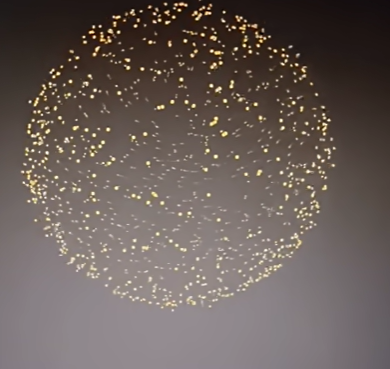
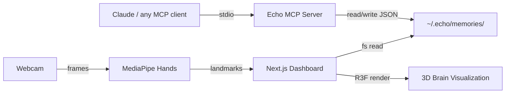

<div align="center">

# Echo

### Your memory, made visible.



**A personalized memory MCP server with a 3D brain dashboard and gesture-controlled recall.**

[](LICENSE)
[](#roadmap)
[](#stack)

</div>

---

## The problem

Most memory MCP servers are key-value stores with extra steps. You save a string, you retrieve a string. There's no shape to what your AI knows about you.

Echo treats memory as a **living thing** — categorized, time-decayed, traceable, and visible.

## What you get

- **An MCP server** that any Claude client can call: `save_memory`, `recall`, `search`, `list_by_category`, `forget`.
- **Structured memory** with categories, tags, freshness scoring (30-day half-life), and full provenance — every fact knows where it came from.
- **A 3D brain dashboard** built in React Three Fiber. Memories cluster into seven regions you can hover, click, or — once you turn on the camera — **point at with your finger** using MediaPipe hand tracking.
- **Local-first, privacy-first.** Your memories live in `~/.echo/memories/` as plain JSON. Hand tracking runs entirely in your browser; no frames leave the machine.

## Quick start

```bash
git clone https://github.com/Waleee7/echo.git
cd echo

# 1. MCP server
cd server
npm install
npm run build

# 2. Register with Claude Code
claude mcp add echo node "$PWD/dist/index.js" --scope user

# 3. Dashboard (optional, in a second terminal)
cd ../dashboard
npm install
npm run dev
# open http://localhost:3000
```

Then in any Claude session: ask it to "save a memory that..." or "recall what you know about..." — Echo's tools are now available.

## The five tools

| Tool | What it does |
|------|--------------|
| `save_memory` | Create or update a memory by id. Required: title, body, category. Optional: tags, related ids, source. |
| `recall` | Pull the full body of one memory by id. |
| `search` | Free-text rank across all memory titles, bodies, and tags. Returns snippets. |
| `list_by_category` | List memories optionally filtered by category, sorted by freshness. |
| `forget` | Delete a memory by id. |

## Categories (the brain regions)

| Category | Brain region | What lives here |
|----------|-------------|-----------------|
| `user` | **Self** | Who you are — role, expertise, ongoing goals |
| `persona` | **Voice** | How you want the AI to talk, address you, behave |
| `feedback` | **Habits** | Corrections and confirmed approaches |
| `project` | **Missions** | Active work, deadlines, motivations |
| `preference` | **Tastes** | Small choices, defaults, formatting preferences |
| `incident` | **Events** | Notable things worth remembering |
| `reference` | **Pointers** | Where to look for info in external systems |

## Architecture



## Stack

- **Server:** TypeScript, `@modelcontextprotocol/sdk`, Node.js stdio
- **Storage:** Plain JSON files, one per memory
- **Dashboard:** Next.js 15, React 19, Tailwind, React Three Fiber, drei
- **Vision:** MediaPipe Tasks Vision (hand landmarker, browser-local)

## Roadmap

- **v0.1.0** — MCP server, 5 tools, brain dashboard, hand tracking ✅
- **v0.2** — Semantic search via embeddings, voice input, conflict detection
- **v0.3** — Cross-runtime sync (web + mobile + CLI all share one memory)
- **v0.4** — Self-introspective tools (`memory.gaps`, `memory.contradicts`)
- **v0.5** — Plugin SDK so others can extend regions, tools, and visualizations

## Why "Echo"?

Memories aren't recordings — they're echoes that get louder when they matter and fade when they don't. The freshness score and decay built into Echo reflect that.

## License

[MIT](LICENSE) — fork it, ship your own version, send a PR if you build something cool.
